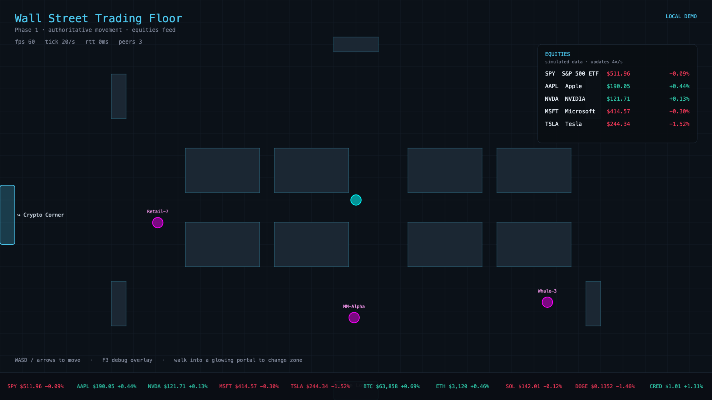

# WallStreetVerse

**A multiplayer trading-floor world with a server-authoritative simulation engine.**

Three connected zones — a Wall Street trading floor, a crypto corner, and a
lounge — on an authoritative 20 Hz tick loop. Clients are dumb terminals: they
send input intents and render snapshots. They never decide where they are.

**[▶ Play the browser demo](https://nicholasvormack.github.io/WallStreetVerse/)** —
the real client running against an in-browser simulator, because GitHub Pages
cannot host a game server. What that does and does not mean is spelled out in
[docs/DEMO.md](docs/DEMO.md).



## What this is

Phase 1 of a persistent multiplayer stock-market world. The interesting problem
is not the sprites, it is keeping a shared, fair, replayable simulation running
across clients on consumer internet:

- **Server authority.** Positions are integrated on the server at a fixed 20 Hz
  tick. Client input is a *request*, validated against the movement model, never
  a coordinate.
- **Client prediction.** The local player moves immediately on input, then
  reconciles against the authoritative snapshot when it arrives.
- **Snapshot interpolation.** Remote players are rendered 100 ms in the past and
  lerped between the two snapshots bracketing that time, so jitter does not
  become teleporting.
- **Zone routing with transfer tokens.** Walking into a portal asks the server
  for a token; the server issues one through Redis with a TTL, and the client
  redeems it to join the target room. You cannot join a room by guessing a URL.
- **Real infrastructure.** Postgres and Redis behind the room servers, wired in
  `docker-compose.yml` and ready for `docker compose up -d`.

## Stack

| Layer | Technology | Why |
| --- | --- | --- |
| Client | Phaser 3 + Vite + TypeScript | Fast 2D renderer, instant HMR, no framework tax |
| Transport | WebSocket + msgpackr | Compact frames; the same codec both directions |
| Rooms | Colyseus 0.5 | Room lifecycle and matchmaking without inventing a protocol |
| HTTP | Fastify + zod | Auth and health routes with validated payloads |
| State | Postgres + Redis | Durable accounts; ephemeral transfer tokens |
| Build | npm workspaces + tsc | One repo, three packages, one install |

## Quick start

### Browser demo (no backend)

```bash
npm ci
npm run build:shared
npm run dev:client
```

Open http://127.0.0.1:5173 and walk around. No `VITE_WS_URL` means the client
uses the built-in `LocalServer` simulator.

### Full authoritative stack

```bash
docker compose up -d                       # Postgres :5432, Redis :6379
npm ci
npm run build:shared
npm run dev:server                         # Colyseus + Fastify on :2567
VITE_WS_URL=ws://127.0.0.1:2567 npm run dev:client
```

### Controls

| Key | Action |
| --- | --- |
| `WASD` / arrows | Move |
| `F3` | Debug overlay: wireframes, snapshot trails, observed snapshot rate |
| walk into a portal | Transfer zone |

## Architecture

```
packages/shared     constants, domain types, collision math, wire schemas
packages/server     Colyseus rooms + fixed-tick simulation + Fastify + Postgres/Redis
packages/client     Phaser scene, prediction, interpolation, transport (Network | LocalServer)
packages/uws-shim   drop-in `ws` shim for colyseus 0.5, which imports unmaintained uws
```

```
input intent ──▶ room.onMessage ──▶ InputQueue
                                      │
                       FixedTickLoop (20 Hz) ──▶ integrate ──▶ resolve collisions
                                      │
                                      ├──▶ portal overlap? ──▶ Redis transfer token ──▶ client
                                      └──▶ broadcast snapshot (msgpack)
```

The full walkthrough — tick loop, protocol frames, portal security model, and
the trade-offs behind each — is in [docs/ARCHITECTURE.md](docs/ARCHITECTURE.md).

## Status and honest limitations

**Working:** three rooms with distinct collision geometry, authoritative
movement, client prediction and reconciliation, snapshot interpolation, portal
transfers with TTL tokens, zone-aware snapshots, a browser demo that needs no
backend, and the market/ticker UI.

**Not built yet:** trading, order books, positions, portfolio persistence. The
market feed on screen is a seeded random walk, clearly labelled as simulated, and
its module is shaped so a real feed can replace it.

**Known rough edges, stated rather than hidden:**

- Zone collision geometry is transcribed in two places — the server rooms and
  `packages/client/src/game/zones.ts`. Serving zone config from the server is the
  correct fix and is not done.
- There is no automated test suite. The client typechecks clean (`tsc`) and
  builds, and the demo is exercised manually, but "no tests" is the accurate
  description.
- `colyseus@0.5` depends on `uws`, which does not compile against modern V8.
  `packages/uws-shim` provides the `ws`-compatible subset actually used. This is
  a workaround, not a fix; upgrading Colyseus removes it.

## License

MIT. See [LICENSE](LICENSE).
